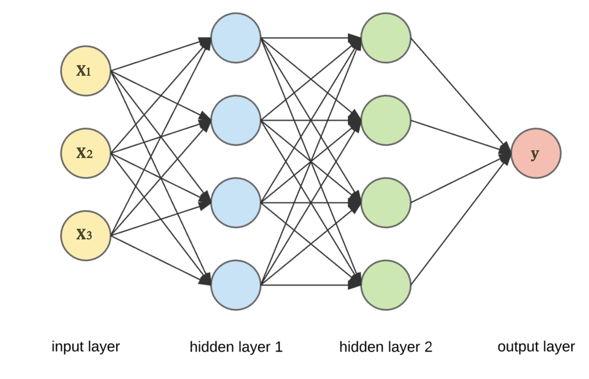
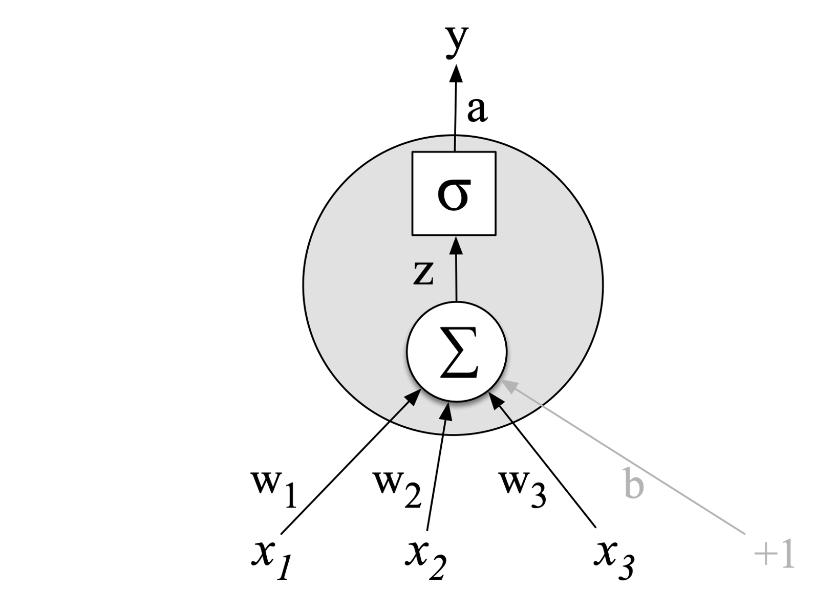

# Lab 6 - Deep Learning for NLP

This file is the complete lab as a readable document: the explanations, the code, and the printed outputs, in the same order as the notebook [Lab6_Deep_Learning_for_NLP.ipynb](Lab6_Deep_Learning_for_NLP.ipynb).
Open the notebook to run the cells yourself.

---

# Deep Learning for NLP

**Deep Learning** is a type of Machine Learning that uses **Neural Networks with multiple layers** to learn patterns from data.

Deep Learning can be used in NLP tasks such as:
- Text Classification
- Sentiment Analysis
- Question Answering

In this lab, we will build a **deep learning model** to classify Yelp restaurant reviews as:

- **0 = Negative**
- **1 = Positive**





## 1. Load the Yelp Dataset

Each row contains:

- a restaurant review
- its sentiment label

```python
import pandas as pd

df = pd.read_csv("07-yelp-dataset.txt", sep="\t", names=["review", "label"])

print("Number of reviews:", len(df))
df.head()
```

Output:

```text
Number of reviews: 1000
                                              review  label
0                           Wow... Loved this place.      1
1                                 Crust is not good.      0
2          Not tasty and the texture was just nasty.      0
3  Stopped by during the late May bank holiday of...      1
4  The selection on the menu was great and so wer...      1
```

```python
print(df["label"].value_counts())
```

Output:

```text
label
1    500
0    500
Name: count, dtype: int64
```

## 2. Preprocessing the Dataset

```python
import re

def preprocess_text(text):

    # 1. Convert to lowercase
    text = text.lower()

    # 2. Remove punctuation and special characters
    text = re.sub(r'[^a-zA-Z\s]', '', text)

    # 3. Remove extra spaces
    text = re.sub(r'\s+', ' ', text).strip()

    return text

    df["review"] = df["review"].apply(preprocess_text)
    df.head()
```

## 3. Split the Data

We divide the dataset into:

- **80% training data** — used to train the model
- **20% testing data** — used to evaluate the model

`stratify=y` keeps the proportion of positive and negative reviews similar in both sets.

```python
from sklearn.model_selection import train_test_split

X = df["review"]
y = df["label"]

X_train, X_test, y_train, y_test = train_test_split(X, y, test_size=0.20, random_state=42)

print("Training reviews:", len(X_train))
print("Testing reviews:", len(X_test))
```

Output:

```text
Training reviews: 800
Testing reviews: 200
```

## 4. Convert Text to TF-IDF Vectors

A neural network cannot directly understand text.

**TF-IDF converts each review into a vector of numbers.**

```python
from sklearn.feature_extraction.text import TfidfVectorizer

tfidf = TfidfVectorizer(max_features=1000, lowercase=True)

X_train_tfidf = tfidf.fit_transform(X_train)
X_test_tfidf = tfidf.transform(X_test)

print("Training TF-IDF shape:", X_train_tfidf.shape)
print("Testing TF-IDF shape:", X_test_tfidf.shape)
```

Output:

```text
Training TF-IDF shape: (800, 1000)
Testing TF-IDF shape: (200, 1000)
```

## 5. Convert the Data to PyTorch Tensors

PyTorch neural networks work with **tensors**.

```python
import torch
import torch.nn as nn

# Convert TF-IDF data to PyTorch tensors
X_train_tensor = torch.FloatTensor(X_train_tfidf.toarray())
X_test_tensor = torch.FloatTensor(X_test_tfidf.toarray())

y_train_tensor = torch.FloatTensor(y_train.values).reshape(-1, 1)
```

## 6. Build a Simple Neural Network

Our network has:

1. **Input layer** — receives the TF-IDF features
2. **Hidden layer** — learns useful patterns
3. **ReLU activation** — adds non-linearity
4. **Output layer** — produces one value for binary classification

We do **not** put `Sigmoid` inside the model because `BCEWithLogitsLoss` applies it internally in a numerically stable way.

```python
input_size = X_train_tensor.shape[1]
# torch.size([800, 1000])

model = nn.Sequential(
    nn.Linear(input_size, 64),   # Input layer
    nn.ReLU(),

    nn.Linear(64, 32),           # Hidden layer
    nn.ReLU(),

    nn.Linear(32, 1)             # Output layer
)

print(model)
```

Output:

```text
Sequential(
  (0): Linear(in_features=1000, out_features=64, bias=True)
  (1): ReLU()
  (2): Linear(in_features=64, out_features=32, bias=True)
  (3): ReLU()
  (4): Linear(in_features=32, out_features=1, bias=True)
)
```

## 7. Choose the Loss Function and Optimizer

- **BCEWithLogitsLoss** is used for binary classification.
To measure the model’s mistakes.
- **Adam** is responsible for changing the model's weights so that the loss becomes smaller.

```python
loss_function = nn.BCEWithLogitsLoss()
optimizer = torch.optim.Adam(model.parameters(), lr=0.01)
```

## 8. Train the Neural Network

One **epoch** means the model has seen the full training dataset once.

For every epoch:

1. Make predictions
2. Calculate the loss
3. Calculate gradients with backpropagation
4. Update the weights

```python
epochs = 10

for epoch in range(epochs):
    model.train()

    # 1. Forward pass
    outputs = model(X_train_tensor)

    # 2. Calculate loss
    loss = loss_function(outputs, y_train_tensor)

    # 3. Backpropagation
    loss.backward()

    # 4. Update model weights
    optimizer.step()

    if (epoch + 1) % 5 == 0:
        print(f"Epoch {epoch + 1}/{epochs} - Loss: {loss.item():.4f}")
```

Output:

```text
Epoch 5/10 - Loss: 0.6517
Epoch 10/10 - Loss: 0.4769
```

## 9. Evaluate the Model

The model outputs raw scores called **logits**.

We apply `sigmoid` to convert them to probabilities between 0 and 1.

- Probability **≥ 0.5 → Positive (1)**
- Probability **< 0.5 → Negative (0)**

```python
from sklearn.metrics import accuracy_score, classification_report, confusion_matrix

model.eval()

with torch.no_grad():
    test = model(X_test_tensor)
    test_probabilities = torch.sigmoid(test)
    predictions = (test_probabilities >= 0.5).int().numpy().flatten()

accuracy = accuracy_score(y_test, predictions)

print(f"Test Accuracy: {accuracy:.3f}")
```

Output:

```text
Test Accuracy: 0.755
```

## 10. Classification Report and Confusion Matrix

The classification report shows:

- **Precision**
- **Recall**
- **F1-score**

The confusion matrix shows how many reviews were classified correctly and incorrectly.

```python
print("Classification Report:")
print(classification_report(y_test, predictions, target_names=["Negative", "Positive"]))

print("Confusion Matrix:")
print(confusion_matrix(y_test, predictions))
```

Output:

```text
Classification Report:
              precision    recall  f1-score   support

    Negative       0.68      0.94      0.79        96
    Positive       0.91      0.59      0.71       104

    accuracy                           0.76       200
   macro avg       0.79      0.76      0.75       200
weighted avg       0.80      0.76      0.75       200

Confusion Matrix:
[[90  6]
 [43 61]]
```

## Task 1 – Represent Reviews Using Word2Vec

In the previous part of the lab, TF-IDF was used to convert each review into numerical features.
Now, use Word2Vec instead.

Requirements:
Tokenize the training and testing reviews.
Train a Word2Vec model using the training reviews.
Use:
vector_size = 200
window = 5
min_count = 1
sg = 1

Convert each review into a single vector.
Convert the resulting vectors into PyTorch tensors.

```python
# your solution here
```

## Task 2 – Build a Different Neural Network

Use the Word2Vec vectors from Task 1 as the input to a new neural network.
Your network must contain:
An input layer
Three hidden layers
ReLU activation functions
One output neuron
Use the following architecture:

Input

   ↓

128 neurons

   ↓

64 neurons

   ↓

32 neurons

   ↓

1 output neuron

Train the model using:
, BCEWithLogitsLoss
, Adam optimizer
, Learning rate = 0.001
, 15 epochs.
Then calculate the test accuracy.

```python
# your solution here
```
