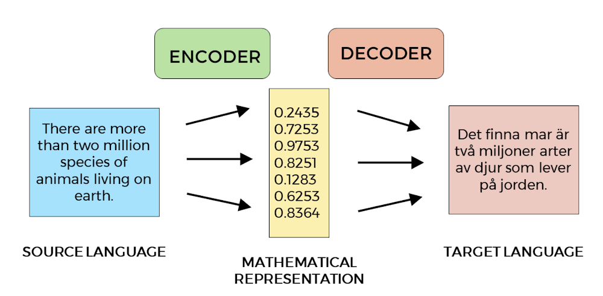
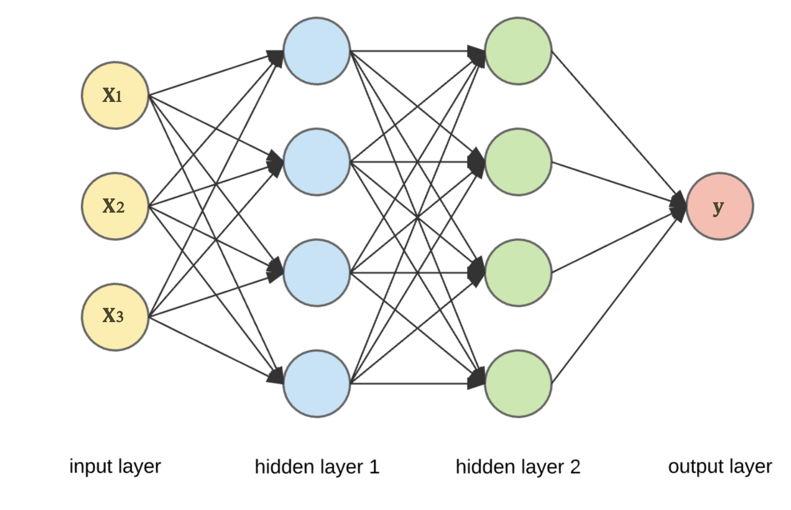

# Lab 10 - Introduction to Machine Translation

This file is the complete lab as a readable document: the explanations, the code, and the printed outputs, in the same order as the notebook [Lab10_Introduction_to_Machine_Translation.ipynb](Lab10_Introduction_to_Machine_Translation.ipynb).
Open the notebook to run the cells yourself.

---

# Introduction to Machine Translation (MT):

Machine Translation is a subfield of AI and linguistics that develops systems capable of translating text from one language to another. The primary goal of machine translation is to enable effective communication between people who speak different languages by automating the process of language translation.


Challenges in Machine Translation:
- Ambiguity

Ex. I went to the bank.
- Idiomatic Expressions

Ex. It's raining cats and dogs.
- Low-Resource Languages

Some languages have very limited data.

Applications of Machine Translation:
- Global Business and E-commerce
-Cross-Cultural Communication
- Multilingual Content Creation
- Language Learning

## Neural Machine Translation:

Neural Machine Translation is a data-driven approach where a single large neural network learns to represent both the source language and the target language, and to directly map between them.
Instead of using manually defined rules or phrase tables, it learns translation patterns automatically from large datasets of bilingual text.

### Key Components of Neural Machine Translation:



```python
#!pip install tensorflow
```

```python
import tensorflow as tf
from tensorflow.keras.preprocessing.text import Tokenizer
import numpy as np

# Example bilingual dataset
english_sentences = ["Hello.", "How are you?", "This is a machine translation example."]
french_sentences = ["Bonjour.", "Comment ça va?", "Ceci est un exemple de traduction automatique."]

# Tokenize the english sentences
tokenizer_eng = Tokenizer()
tokenizer_eng.fit_on_texts(english_sentences) # Tokenize words and assign an integer ID to each unique word
eng_sequences = tokenizer_eng.texts_to_sequences(english_sentences) # Returns a list of tokens replaced by their index. Note: words index will start from 1 because 0 is reserved by default for padding (not assigned to any word).
print(f"eng_sequences = {eng_sequences}")
eng_word_index = tokenizer_eng.word_index # Returns the dictionary created by the tokenizer dict {word: index}.
print(f"eng_word_index = {eng_word_index}")
```

Output:

```text
eng_sequences = [[1], [2, 3, 4], [5, 6, 7, 8, 9, 10]]
eng_word_index = {'hello': 1, 'how': 2, 'are': 3, 'you': 4, 'this': 5, 'is': 6, 'a': 7, 'machine': 8, 'translation': 9, 'example': 10}
```

```python
# Tokenize the french sentences
tokenizer_frn = Tokenizer()
tokenizer_frn.fit_on_texts(french_sentences)
frn_sequences = tokenizer_frn.texts_to_sequences(french_sentences)

print(f"frn_sequences = {frn_sequences}")
frn_word_index = tokenizer_frn.word_index
print(f"frn_word_index = {frn_word_index}")
```

Output:

```text
frn_sequences = [[1], [2, 3, 4], [5, 6, 7, 8, 9, 10, 11]]
frn_word_index = {'bonjour': 1, 'comment': 2, 'ça': 3, 'va': 4, 'ceci': 5, 'est': 6, 'un': 7, 'exemple': 8, 'de': 9, 'traduction': 10, 'automatique': 11}
```

```python
from tensorflow.keras.preprocessing.sequence import pad_sequences

# Padding sequences
eng_padded = pad_sequences(eng_sequences) # makes all sequences the same length by padding with zeros at the beginning (default)
print(f"eng_padded = {eng_padded}")
```

Output:

```text
eng_padded = [[ 0  0  0  0  0  1]
 [ 0  0  0  2  3  4]
 [ 5  6  7  8  9 10]]
```

```python
frn_padded = pad_sequences(frn_sequences)
frn_padded
```

Output:

```text
array([[ 0,  0,  0,  0,  0,  0,  1],
       [ 0,  0,  0,  0,  2,  3,  4],
       [ 5,  6,  7,  8,  9, 10, 11]], dtype=int32)
```

## LSTM Model



```python
from sklearn.model_selection import train_test_split

# Train-test split
eng_train, eng_test, frn_train, frn_test = train_test_split(eng_padded, frn_padded, test_size=0.2, random_state=42)

# Define the model
model = tf.keras.Sequential([
    tf.keras.layers.Embedding(input_dim=len(eng_word_index) + 1, output_dim=64),
    tf.keras.layers.LSTM(64),
    tf.keras.layers.RepeatVector(frn_padded.shape[1]), #length of french sentence
    tf.keras.layers.LSTM(64, return_sequences=True),
    tf.keras.layers.TimeDistributed(tf.keras.layers.Dense(len(frn_word_index) + 1, activation='softmax')) #convert to probabilities for each frn word
])

model.compile(optimizer='adam', loss='sparse_categorical_crossentropy', metrics=['accuracy'])

# Train the model
model.fit(eng_train, np.expand_dims(frn_train, -1), epochs=50, batch_size=1, validation_split=0.2)

# Evaluate the model
loss, accuracy = model.evaluate(eng_test, np.expand_dims(frn_test, -1))
print(f'Test Accuracy: {accuracy}')
```

Output:

```text
WARNING:tensorflow:TensorFlow GPU support is not available on native Windows for TensorFlow >= 2.11. Even if CUDA/cuDNN are installed, GPU will not be used. Please use WSL2 or the TensorFlow-DirectML plugin.
Epoch 1/50
1/1 ━━━━━━━━━━━━━━━━━━━━ 0s 10s/step - accuracy: 0.0000e+00 - loss: 2.4867
1/1 ━━━━━━━━━━━━━━━━━━━━ 12s 12s/step - accuracy: 0.0000e+00 - loss: 2.4867 - val_accuracy: 0.0000e+00 - val_loss: 2.4864
Epoch 2/50
1/1 ━━━━━━━━━━━━━━━━━━━━ 0s 87ms/step - accuracy: 0.5714 - loss: 2.4776
1/1 ━━━━━━━━━━━━━━━━━━━━ 0s 390ms/step - accuracy: 0.5714 - loss: 2.4776 - val_accuracy: 0.0000e+00 - val_loss: 2.4883
Epoch 3/50
1/1 ━━━━━━━━━━━━━━━━━━━━ 0s 68ms/step - accuracy: 0.5714 - loss: 2.4686
1/1 ━━━━━━━━━━━━━━━━━━━━ 0s 293ms/step - accuracy: 0.5714 - loss: 2.4686 - val_accuracy: 0.0000e+00 - val_loss: 2.4903
Epoch 4/50
1/1 ━━━━━━━━━━━━━━━━━━━━ 0s 117ms/step - accuracy: 0.5714 - loss: 2.4591
1/1 ━━━━━━━━━━━━━━━━━━━━ 0s 307ms/step - accuracy: 0.5714 - loss: 2.4591 - val_accuracy: 0.0000e+00 - val_loss: 2.4926
Epoch 5/50
1/1 ━━━━━━━━━━━━━━━━━━━━ 0s 154ms/step - accuracy: 0.5714 - loss: 2.4486
1/1 ━━━━━━━━━━━━━━━━━━━━ 0s 314ms/step - accuracy: 0.5714 - loss: 2.4486 - val_accuracy: 0.0000e+00 - val_loss: 2.4952
Epoch 6/50
1/1 ━━━━━━━━━━━━━━━━━━━━ 0s 68ms/step - accuracy: 0.5714 - loss: 2.4369
1/1 ━━━━━━━━━━━━━━━━━━━━ 0s 196ms/step - accuracy: 0.5714 - loss: 2.4369 - val_accuracy: 0.0000e+00 - val_loss: 2.4981
Epoch 7/50
1/1 ━━━━━━━━━━━━━━━━━━━━ 0s 58ms/step - accuracy: 0.5714 - loss: 2.4235
1/1 ━━━━━━━━━━━━━━━━━━━━ 0s 187ms/step - accuracy: 0.5714 - loss: 2.4235 - val_accuracy: 0.0000e+00 - val_loss: 2.5014
Epoch 8/50
1/1 ━━━━━━━━━━━━━━━━━━━━ 0s 56ms/step - accuracy: 0.5714 - loss: 2.4079
1/1 ━━━━━━━━━━━━━━━━━━━━ 0s 224ms/step - accuracy: 0.5714 - loss: 2.4079 - val_accuracy: 0.0000e+00 - val_loss: 2.5052
Epoch 9/50
1/1 ━━━━━━━━━━━━━━━━━━━━ 0s 55ms/step - accuracy: 0.5714 - loss: 2.3897
1/1 ━━━━━━━━━━━━━━━━━━━━ 0s 182ms/step - accuracy: 0.5714 - loss: 2.3897 - val_accuracy: 0.0000e+00 - val_loss: 2.5096
Epoch 10/50
1/1 ━━━━━━━━━━━━━━━━━━━━ 0s 57ms/step - accuracy: 0.5714 - loss: 2.3682
... (output truncated)
```

```python
# Inference
def translate_sentence(sentence, model, eng_tokenizer, frn_tokenizer):
    sequence = eng_tokenizer.texts_to_sequences([sentence])
    padded_sequence = pad_sequences(sequence, maxlen=eng_padded.shape[1])
    predicted_sequence = model.predict(padded_sequence) #outputs probabilities for each timestep (french padded sentence) and each unique word in the target vocabulary.
    translated_sequence = np.argmax(predicted_sequence, axis=-1) #Returns the index (word ID) with the largest value at each timestep.
    translated_sentence = frn_tokenizer.sequences_to_texts(translated_sequence)
    return translated_sentence[0]

# Example Inference
input_sentence = "How are you?"
translated_sentence = translate_sentence(input_sentence, model, tokenizer_eng, tokenizer_frn)
print(f'Input: {input_sentence}\nTranslation: {translated_sentence}')
```

Output:

```text
1/1 ━━━━━━━━━━━━━━━━━━━━ 0s 1s/step
1/1 ━━━━━━━━━━━━━━━━━━━━ 1s 1s/step
Input: How are you?
Translation: comment va va
```

---

### Task 1: Understanding the Model Layers

Answer these simple questions in your own words:

1. What does the **Embedding** layer do to a word index?
3. What is the role of the **Encoder LSTM**?
5. What does the **Decoder LSTM** do?
8. Why do we use `softmax` in the final layer?

**Answers.**

1. **Embedding layer.** A word index is only an integer id with no meaning. The Embedding layer looks the id up in a trainable table and returns a dense vector of 64 numbers, so words get vectors the network can compare and combine. The table is learned during training.
2. **Encoder LSTM.** It reads the embedded English words one time step after another and compresses the whole sentence into one fixed-size state vector of 64 numbers, the summary of the source sentence.
3. **Decoder LSTM.** It receives the encoder's state (copied once per output position by `RepeatVector`) and unrolls it into a sequence: at each time step it produces a hidden state that represents the next French word, and `return_sequences=True` keeps one output per position.
4. **softmax in the final layer.** At each output position the `TimeDistributed(Dense)` layer gives one score per French vocabulary word. `softmax` turns the scores into probabilities that sum to 1, so the most probable word is the prediction and the model can be trained with `sparse_categorical_crossentropy` against the true word id.

### Task 2:

 Use Case: Language Translation (English-French)

A global e-commerce company wants to expand its reach to French-speaking customers and provide a seamless shopping experience. The company needs a language translation solution to automatically translate product listings, customer reviews, and other relevant content from English to French.

link: https://www.kaggle.com/datasets/devicharith/language-translation-englishfrench

**Step 1 - Load the Kaggle dataset.** `eng_-french.csv` has about 175 000 English-French sentence pairs (12.5 MB, so it is not committed to the repo). The cell reads it from `dataset/` if the file is there, otherwise it downloads it with `kagglehub`. The two columns are renamed to `english` and `french`.

```python
import pandas as pd, numpy as np, re, os
import tensorflow as tf
from tensorflow.keras.preprocessing.text import Tokenizer
from tensorflow.keras.preprocessing.sequence import pad_sequences

csv_path = "dataset/eng_-french.csv"
if not os.path.exists(csv_path):
    import kagglehub
    folder = kagglehub.dataset_download("devicharith/language-translation-englishfrench")
    csv_path = os.path.join(folder, "eng_-french.csv")

data = pd.read_csv(csv_path)
data.columns = ["english", "french"]
print("Total sentence pairs:", len(data))
display(data.head())
```

Output:

```text
Total sentence pairs: 175621
  english      french
0     Hi.      Salut!
1    Run!     Cours !
2    Run!    Courez !
3    Who?       Qui ?
4    Wow!  Ça alors !
```

**Step 2 - Clean and select a small subset.** Lowercase, keep only letters and apostrophes, keep short sentences (at most 6 English / 8 French words) and sample 8 000 pairs so the model trains on a CPU in a few minutes.

```python
def clean(s):
    s = s.lower().strip()
    return re.sub(r"[^a-zàâçéèêëîïôûùüÿœæ' ]+", " ", s)

data["english"] = data["english"].astype(str).map(clean)
data["french"]  = data["french"].astype(str).map(clean)
data = data[(data["english"].str.split().str.len() <= 6) & (data["french"].str.split().str.len() <= 8)]
data = data.drop_duplicates("english").sample(n=8000, random_state=42)

print("Pairs used:", len(data))
display(data.head())
```

Output:

```text
Pairs used: 8000
                               english  \
72887       where is the bus schedule    
100139  well  what does that tell you    
39625           are you still in love    
46810          he does not wear a hat    
23733              i did all the work    

                                           french  
72887               où sont les horaires de bus    
100139  eh bien  qu'est ce que cela vous évoque    
39625                      es tu encore amoureux   
46810                 il ne porte pas de chapeau   
23733                  j'ai fait tout le travail
```

**Step 3 - Tokenize and pad both languages**, exactly as in the lab: one `Tokenizer` per language, integer sequences, zero padding (after the words this time, with `padding="post"`).

```python
tok_eng = Tokenizer(); tok_eng.fit_on_texts(data["english"])
tok_frn = Tokenizer(); tok_frn.fit_on_texts(data["french"])

eng_seq = pad_sequences(tok_eng.texts_to_sequences(data["english"]), padding="post")
frn_seq = pad_sequences(tok_frn.texts_to_sequences(data["french"]), padding="post")

print("English vocabulary:", len(tok_eng.word_index), "| French vocabulary:", len(tok_frn.word_index))
print("English max length:", eng_seq.shape[1], "| French max length:", frn_seq.shape[1])
print("First pair as numbers:", eng_seq[0], "->", frn_seq[0])
```

Output:

```text
English vocabulary: 4086 | French vocabulary: 5583
English max length: 6 | French max length: 8
First pair as numbers: [  94    5    3  684 1073    0] -> [  82   28   19 2461    2  633    0    0]
```

**Step 4 - Build the encoder-decoder LSTM.** The same five layers as the lab model (Embedding → encoder LSTM → RepeatVector → decoder LSTM → TimeDistributed Dense with softmax), with bigger sizes because the vocabulary is bigger. `mask_zero=True` tells the LSTM to ignore the padding.

```python
from sklearn.model_selection import train_test_split

eng_tr, eng_te, frn_tr, frn_te = train_test_split(eng_seq, frn_seq, test_size=0.1, random_state=42)

mt_model = tf.keras.Sequential([
    tf.keras.layers.Embedding(input_dim=len(tok_eng.word_index) + 1, output_dim=128, mask_zero=True),
    tf.keras.layers.LSTM(256),                                   # encoder: sentence -> one state vector
    tf.keras.layers.RepeatVector(frn_seq.shape[1]),              # one copy per French position
    tf.keras.layers.LSTM(256, return_sequences=True),            # decoder: one state per French word
    tf.keras.layers.TimeDistributed(tf.keras.layers.Dense(len(tok_frn.word_index) + 1, activation="softmax")),
])
mt_model.compile(optimizer="adam", loss="sparse_categorical_crossentropy", metrics=["accuracy"])
mt_model.build(input_shape=(None, eng_seq.shape[1]))
mt_model.summary()
```

Output:

```text
Model: "sequential_1"
┏━━━━━━━━━━━━━━━━━━━━━━━━━━━━━━━━━┳━━━━━━━━━━━━━━━━━━━━━━━━┳━━━━━━━━━━━━━━━┓
┃ Layer (type)                    ┃ Output Shape           ┃       Param # ┃
┡━━━━━━━━━━━━━━━━━━━━━━━━━━━━━━━━━╇━━━━━━━━━━━━━━━━━━━━━━━━╇━━━━━━━━━━━━━━━┩
│ embedding_1 (Embedding)         │ (None, 6, 128)         │       523,136 │
├─────────────────────────────────┼────────────────────────┼───────────────┤
│ lstm_2 (LSTM)                   │ (None, 256)            │       394,240 │
├─────────────────────────────────┼────────────────────────┼───────────────┤
│ repeat_vector_1 (RepeatVector)  │ (None, 8, 256)         │             0 │
├─────────────────────────────────┼────────────────────────┼───────────────┤
│ lstm_3 (LSTM)                   │ (None, 8, 256)         │       525,312 │
├─────────────────────────────────┼────────────────────────┼───────────────┤
│ time_distributed_1              │ (None, 8, 5584)        │     1,435,088 │
│ (TimeDistributed)               │                        │               │
└─────────────────────────────────┴────────────────────────┴───────────────┘
 Total params: 2,877,776 (10.98 MB)
 Trainable params: 2,877,776 (10.98 MB)
 Non-trainable params: 0 (0.00 B)
```

**Step 5 - Train and evaluate.** 25 epochs with batches of 64; 10 % of the training pairs are kept for validation. The accuracy counts correct French tokens per position (padding included), so it is optimistic.

```python
history = mt_model.fit(eng_tr, np.expand_dims(frn_tr, -1), epochs=25, batch_size=64, validation_split=0.1, verbose=2)

loss, acc = mt_model.evaluate(eng_te, np.expand_dims(frn_te, -1), verbose=0)
print(f"\nTest token accuracy: {acc:.3f}")
```

Output:

```text
Epoch 1/25
102/102 - 48s - 472ms/step - accuracy: 0.3461 - loss: 5.5812 - val_accuracy: 0.3580 - val_loss: 4.8876
Epoch 2/25
102/102 - 40s - 390ms/step - accuracy: 0.3654 - loss: 4.6614 - val_accuracy: 0.3800 - val_loss: 4.7273
Epoch 3/25
102/102 - 32s - 310ms/step - accuracy: 0.3740 - loss: 4.4774 - val_accuracy: 0.3811 - val_loss: 4.6297
Epoch 4/25
102/102 - 29s - 288ms/step - accuracy: 0.3829 - loss: 4.3565 - val_accuracy: 0.3920 - val_loss: 4.5787
Epoch 5/25
102/102 - 30s - 296ms/step - accuracy: 0.3885 - loss: 4.2773 - val_accuracy: 0.3924 - val_loss: 4.5344
Epoch 6/25
102/102 - 32s - 309ms/step - accuracy: 0.3914 - loss: 4.2164 - val_accuracy: 0.3960 - val_loss: 4.5153
Epoch 7/25
102/102 - 32s - 318ms/step - accuracy: 0.3934 - loss: 4.1630 - val_accuracy: 0.3955 - val_loss: 4.5034
Epoch 8/25
102/102 - 30s - 290ms/step - accuracy: 0.3951 - loss: 4.1161 - val_accuracy: 0.3969 - val_loss: 4.5014
Epoch 9/25
102/102 - 29s - 280ms/step - accuracy: 0.3966 - loss: 4.0763 - val_accuracy: 0.3939 - val_loss: 4.4943
Epoch 10/25
102/102 - 29s - 280ms/step - accuracy: 0.3972 - loss: 4.0400 - val_accuracy: 0.3953 - val_loss: 4.4948
Epoch 11/25
102/102 - 28s - 275ms/step - accuracy: 0.3988 - loss: 4.0067 - val_accuracy: 0.3948 - val_loss: 4.4864
Epoch 12/25
102/102 - 28s - 272ms/step - accuracy: 0.4020 - loss: 3.9692 - val_accuracy: 0.3998 - val_loss: 4.4587
Epoch 13/25
102/102 - 28s - 271ms/step - accuracy: 0.4073 - loss: 3.9173 - val_accuracy: 0.4010 - val_loss: 4.4578
Epoch 14/25
102/102 - 28s - 271ms/step - accuracy: 0.4143 - loss: 3.8583 - val_accuracy: 0.4089 - val_loss: 4.4101
Epoch 15/25
102/102 - 28s - 272ms/step - accuracy: 0.4179 - loss: 3.7967 - val_accuracy: 0.4043 - val_loss: 4.3935
... (output truncated)
```

**Step 6 - Translate e-commerce sentences.** The same inference function as the lab: tokenize and pad the English sentence, predict a probability table, take the `argmax` per position, and convert the ids back to French words.

```python
def translate(sentence):
    seq = pad_sequences(tok_eng.texts_to_sequences([clean(sentence)]), maxlen=eng_seq.shape[1], padding="post")
    pred = np.argmax(mt_model.predict(seq, verbose=0), axis=-1)
    return tok_frn.sequences_to_texts(pred)[0]

for s in ["i love this product", "it is very cheap", "the shoes are too small", "thank you very much", "where is my order"]:
    print(f"{s:28s} -> {translate(s)}")
```

Output:

```text
i love this product          -> j'aime le
it is very cheap             -> il est est la
the shoes are too small      -> le a a de de
thank you very much          -> nous le
where is my order            -> il est une
```

**Observation.** The model learns the dataset only partly: token accuracy reaches about 0.45 on the test pairs and the translations of the e-commerce sentences are mostly wrong (a few first words are right, then the decoder repeats frequent words such as "est" and "la"). This is expected for a plain sequence-to-sequence LSTM trained on 8 000 short pairs for 25 epochs on a CPU: one 256-number state vector has to carry the whole English sentence, the French vocabulary has 5 583 words, and most of them are seen only a few times. For the company's real content (listings, reviews) the next steps would be far more data and training, an attention mechanism between encoder and decoder (Lab 11), or a pre-trained transformer such as MarianMT or FLAN-T5 (Lab 7), and a BLEU score on a held-out set to measure quality instead of token accuracy.
