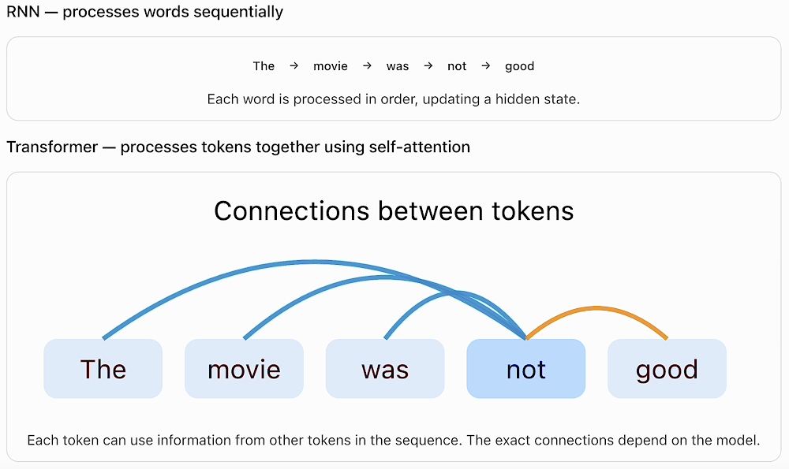
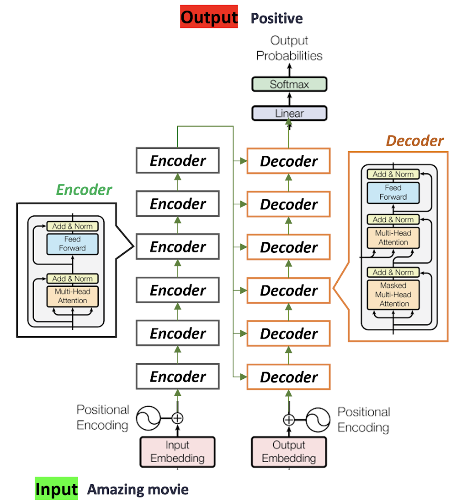
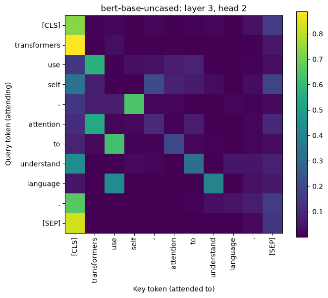

# Lab 12 - Transformers

This file is the complete lab as a readable document: the explanations, the code, and the printed outputs, in the same order as the notebook [Lab12_Transformers.ipynb](Lab12_Transformers.ipynb).
Open the notebook to run the cells yourself.

---

# Transformers

#### A Transformer is a deep learning architecture designed to process sequences of text using self-attention.

- Transformers are the foundation of many modern NLP models, including BERT, GPT, and T5.

- Before Transformers, we used models such as RNNs and LSTMs for NLP tasks.



```python
%pip -q install transformers torch matplotlib
```

Output:

```text
Note: you may need to restart the kernel to use updated packages.
```

## 1. Load a Transformer

We use **DistilBERT**, a  Transformer fine-tuned for positive/negative sentiment classification.

```python
from transformers import AutoTokenizer, AutoModelForSequenceClassification
import torch

model_name = "distilbert-base-uncased-finetuned-sst-2-english"

tokenizer = AutoTokenizer.from_pretrained(model_name)

model = AutoModelForSequenceClassification.from_pretrained(model_name)
model.eval()

# Look inside the Transformer architecture.
print("Transformer layers:", model.config.n_layers)
print("Attention heads per layer:", model.config.n_heads)
print("Hidden size:", model.config.dim)
```

Output:

```text
Transformer layers: 6
Attention heads per layer: 12
Hidden size: 768
```



## 2. Tokenizing the text

```python
sentence = "The movie was not good."

# Tokenization: converts text into token IDs
inputs = tokenizer(sentence, return_tensors="pt")

# [CLS] = start token, [SEP] = end token
tokens = tokenizer.convert_ids_to_tokens(inputs["input_ids"][0])

print("Tokens:", tokens)
```

Output:

```text
Tokens: ['[CLS]', 'the', 'movie', 'was', 'not', 'good', '.', '[SEP]']
```

## 3. Embeddings and self-attention

Each token ID becomes a **vector (embedding)**. Inside each Transformer layer, **self-attention** lets a token use information from other tokens in the same sentence.

```python
import torch

# Enable attention weights
model.set_attn_implementation("eager")

with torch.no_grad():
    embeddings = model.distilbert.embeddings(inputs["input_ids"])
    outputs = model(**inputs, output_attentions=True)

# Attention from the first layer and first head
attention = outputs.attentions[0][0, 0]

print("Embeddings shape:", embeddings.shape)
print("Attention shape:", attention.shape)
print("Tokens:", tokens)
print("Attention weights:\n", attention)
```

Output:

```text
Embeddings shape: torch.Size([1, 8, 768])
Attention shape: torch.Size([8, 8])
Tokens: ['[CLS]', 'the', 'movie', 'was', 'not', 'good', '.', '[SEP]']
Attention weights:
 tensor([[0.1145, 0.0938, 0.0681, 0.0701, 0.0596, 0.0800, 0.1593, 0.3546],
        [0.4147, 0.0793, 0.0481, 0.1018, 0.1084, 0.0805, 0.0789, 0.0883],
        [0.1634, 0.0327, 0.0975, 0.0403, 0.1819, 0.1402, 0.0866, 0.2574],
        [0.2882, 0.1014, 0.0504, 0.0669, 0.2180, 0.1009, 0.1231, 0.0511],
        [0.3612, 0.0501, 0.0696, 0.1200, 0.0642, 0.1304, 0.0953, 0.1092],
        [0.3065, 0.0469, 0.1175, 0.1915, 0.0630, 0.0555, 0.1120, 0.1071],
        [0.3505, 0.0935, 0.0572, 0.0753, 0.0972, 0.0964, 0.1165, 0.1135],
        [0.3513, 0.1019, 0.0318, 0.0541, 0.1036, 0.0607, 0.0755, 0.2210]])
```

## 4. Classification: From Transformer to prediction

The Transformer produces contextual representations. The **classification head** turns them into two scores (*logits*). **Softmax** converts these into probabilities that sum to 1.

```python
# Get prediction scores from the Transformer
with torch.no_grad():
    logits = model(**inputs).logits

# Convert scores into probabilities
probs = torch.softmax(logits, dim=1)[0]

# Display the prediction
prediction = probs.argmax().item()

print("Prediction:", model.config.id2label[prediction])
print("Confidence:", round(probs[prediction].item(), 3))
```

Output:

```text
Prediction: NEGATIVE
Confidence: 1.0
```

### Task: Exploring Transformer Layers and Attention Heads

Load the pretrained **`bert-base-uncased`** model using Hugging Face Transformers.

1. Write code to print the number of Transformer layers and the number of attention heads per layer.
2. Calculate and print the total number of attention heads across all Transformer layers.
3. Using the sentence `"Transformers use self-attention to understand language."`, extract the attention weights from the **third Transformer layer and second attention head**.
4. Explain what the rows and columns of the attention matrix represent.

### Solution

**Step 1 - Load BERT.** Load the tokenizer and the base `bert-base-uncased` encoder. `attn_implementation="eager"` makes the model return its attention weights, and `eval()` switches off dropout so the weights are deterministic.

```python
from transformers import AutoTokenizer, AutoModel
import torch

bert_name = "bert-base-uncased"
bert_tokenizer = AutoTokenizer.from_pretrained(bert_name)
bert_model = AutoModel.from_pretrained(bert_name, attn_implementation="eager")
bert_model.eval()

print(type(bert_model).__name__)
```

Output:

```text
BertModel
```

**Step 2 - Task 1: layers and heads per layer.** Both numbers are stored in the model configuration.

```python
num_layers = bert_model.config.num_hidden_layers
heads_per_layer = bert_model.config.num_attention_heads

print("Number of Transformer layers:", num_layers)
print("Attention heads per layer:", heads_per_layer)
```

Output:

```text
Number of Transformer layers: 12
Attention heads per layer: 12
```

**Step 3 - Task 2: total number of attention heads.** Every layer has the same number of heads, so the total is layers multiplied by heads per layer.

```python
total_heads = num_layers * heads_per_layer
print("Total attention heads:", num_layers, "x", heads_per_layer, "=", total_heads)
```

Output:

```text
Total attention heads: 12 x 12 = 144
```

**Step 4 - Task 3: tokenize the sentence.** The tokenizer adds `[CLS]` at the start and `[SEP]` at the end, and may split rare words into word pieces.

```python
task_sentence = "Transformers use self-attention to understand language."
task_inputs = bert_tokenizer(task_sentence, return_tensors="pt")
task_tokens = bert_tokenizer.convert_ids_to_tokens(task_inputs["input_ids"][0])

print("Tokens:", task_tokens)
print("Number of tokens:", len(task_tokens))
```

Output:

```text
Tokens: ['[CLS]', 'transformers', 'use', 'self', '-', 'attention', 'to', 'understand', 'language', '.', '[SEP]']
Number of tokens: 11
```

**Step 5 - Run BERT and keep the attentions.** With `output_attentions=True` the model returns one attention tensor per layer, each shaped `(batch, heads, tokens, tokens)`.

```python
with torch.no_grad():
    task_outputs = bert_model(**task_inputs, output_attentions=True)

print("Attention tensors returned:", len(task_outputs.attentions))
print("Shape of one layer's attention:", tuple(task_outputs.attentions[0].shape))
```

Output:

```text
Attention tensors returned: 12
Shape of one layer's attention: (1, 12, 11, 11)
```

**Step 6 - Select the third layer and the second head.** Python counts from 0, so the third layer is index `2` and the second head is index `1`. The result is a square matrix with one row and one column per token.

```python
import pandas as pd

layer_index = 2   # third Transformer layer
head_index = 1    # second attention head

attention_l3_h2 = task_outputs.attentions[layer_index][0, head_index]
print("Attention matrix shape:", tuple(attention_l3_h2.shape))

attention_table = pd.DataFrame(attention_l3_h2.numpy(), index=task_tokens, columns=task_tokens).round(3)
attention_table
```

Output:

```text
Attention matrix shape: (11, 11)
              [CLS]  transformers    use   self      -  attention     to  \
[CLS]         0.732         0.008  0.011  0.006  0.017      0.007  0.010   
transformers  0.889         0.005  0.034  0.000  0.003      0.005  0.001   
use           0.143         0.569  0.005  0.035  0.041      0.068  0.090   
self          0.340         0.073  0.002  0.000  0.202      0.081  0.064   
-             0.143         0.070  0.071  0.639  0.012      0.013  0.003   
attention     0.113         0.545  0.012  0.020  0.111      0.010  0.072   
to            0.084         0.022  0.622  0.008  0.009      0.194  0.011   
understand    0.434         0.005  0.002  0.022  0.012      0.003  0.330   
language      0.051         0.001  0.429  0.002  0.004      0.001  0.005   
.             0.658         0.006  0.003  0.001  0.004      0.003  0.009   
[SEP]         0.828         0.001  0.001  0.000  0.001      0.001  0.002   

              understand  language      .  [SEP]  
[CLS]              0.012     0.006  0.039  0.155  
transformers       0.001     0.000  0.005  0.057  
use                0.000     0.005  0.009  0.034  
self               0.026     0.002  0.028  0.183  
-                  0.003     0.014  0.009  0.022  
attention          0.000     0.000  0.016  0.100  
to                 0.007     0.001  0.014  0.027  
understand         0.002     0.055  0.053  0.082  
language           0.398     0.006  0.041  0.062  
.                  0.038     0.046  0.073  0.159  
[SEP]              0.002     0.003  0.022  0.139
```

**Step 7 - Check the rows.** Each row comes out of a softmax, so it should add up to 1. The code also prints which token each token attends to most.

```python
row_sums = attention_l3_h2.sum(dim=-1)
print("Row sums:", [round(v, 4) for v in row_sums.tolist()])

for i, token in enumerate(task_tokens):
    j = int(attention_l3_h2[i].argmax())
    print(f"{token:>12} -> attends most to {task_tokens[j]:<12} ({attention_l3_h2[i, j].item():.3f})")
```

Output:

```text
Row sums: [1.0, 1.0, 1.0, 1.0, 1.0, 1.0, 1.0, 1.0, 1.0, 1.0, 1.0]
       [CLS] -> attends most to [CLS]        (0.732)
transformers -> attends most to [CLS]        (0.889)
         use -> attends most to transformers (0.569)
        self -> attends most to [CLS]        (0.340)
           - -> attends most to self         (0.639)
   attention -> attends most to transformers (0.545)
          to -> attends most to use          (0.622)
  understand -> attends most to [CLS]        (0.434)
    language -> attends most to use          (0.429)
           . -> attends most to [CLS]        (0.658)
       [SEP] -> attends most to [CLS]        (0.828)
```

**Step 8 - Visualise the matrix.** A heatmap makes the pattern easier to read: rows are the tokens doing the attending, columns are the tokens being attended to.

```python
import matplotlib.pyplot as plt

fig, ax = plt.subplots(figsize=(7, 6))
im = ax.imshow(attention_l3_h2.numpy(), cmap="viridis")
ax.set_xticks(range(len(task_tokens)))
ax.set_xticklabels(task_tokens, rotation=90)
ax.set_yticks(range(len(task_tokens)))
ax.set_yticklabels(task_tokens)
ax.set_xlabel("Key token (attended to)")
ax.set_ylabel("Query token (attending)")
ax.set_title("bert-base-uncased: layer 3, head 2")
fig.colorbar(im, ax=ax)
plt.tight_layout()
plt.show()
```



**Step 9 - Task 4: what the rows and columns mean.**

**Answer.**

- **Rows are the query tokens:** the token that is "looking". Row *i* shows how token *i* spreads its attention when layer 3 builds its new representation.
- **Columns are the key tokens:** the tokens being looked at. Column *j* is token *j* as a source of information.
- **Each cell (i, j)** is the weight token *i* gives to token *j*. The matrix is 11 x 11 because the sentence becomes 11 tokens, including `[CLS]` and `[SEP]`.
- **Each row is a probability distribution:** it comes out of a softmax, so it adds up to 1. Step 7 confirms this for every row. Columns do not have to add up to 1.
- **The matrix is not symmetric:** `use` gives 0.569 to `transformers`, but `transformers` gives only 0.034 to `use`.

**What this head does on this sentence:**
- **Much of the weight goes to `[CLS]`:** for example `transformers` 0.889, `[SEP]` 0.828 and `.` 0.658. Heads often park attention on a special token when they have nothing useful to pick up.
- **The rest links words that belong together:** `-` attends to `self` (0.639), `to` to `use` (0.622), `use` to `transformers` (0.569), and `language` to `use` (0.429) and `understand` (0.398).
